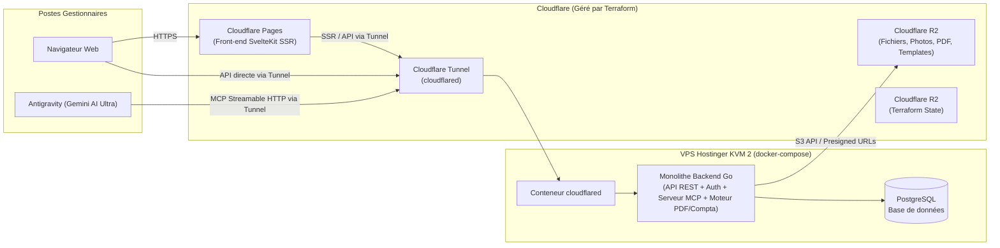

# Gestion Immo — Document de Conception (Design Spec)

**Date :** 2026-10-21  
**Statut :** Prêt pour validation  

---

## 1. Intentions et Pourquoi (« The Why »)

Aujourd'hui, la gestion du patrimoine immobilier repose sur trois outils déconnectés :
1. Une **arborescence de dossiers sur un Drive** (découpée par société/entité légale, type de bien, locataires passés et présents, date d'acquisition, loyers en position négative, dossiers d'assurance loyers impayés [GLI], baux et incidents).
2. Des **tableurs** pour suivre les loyers et les encaissements (dont une part importante réglée en espèces).
3. Le logiciel **EBP**, coûteux, obsolète et inadapté à la gestion locative et patrimoniale, ce qui impose une double saisie permanente avant transmission au cabinet d'expertise comptable (Cabinet SGCAM).

**L'objectif du projet** est de remplacer intégralement les tableurs, l'organisation manuelle sur Drive et le logiciel EBP par une **application web interne (« back-office » pur)** couplée nativement à un **serveur MCP (Model Context Protocol)**.

L'application doit permettre de :
- Centraliser tout le patrimoine immobilier de droit français (détenu via des SCI, des SARL de marchand de biens comme `SARL INVESTISSIMO`, en indivision ou en nom propre) jusqu'au niveau du bail, du locataire, de l'état des lieux et de l'incident.
- Repérer instantanément les **positions négatives** (retards et impayés de loyers).
- **Générer le plus rapidement possible** l'ensemble des documents juridiques (baux, quittances, relances, dossiers complets d'assurance GLI, états des lieux d'entrée et de sortie) et comptables (journaux, FEC, justificatifs pour l'expert-comptable **et** génération directe des *Comptes Annuels* et de la *Liasse Fiscale* sur le modèle des états produits par le Cabinet SGCAM).
- **Exploiter l'IA à coût zéro d'API :** tous les gestionnaires disposant d'un abonnement **Gemini AI Ultra** avec **Antigravity**, l'application n'effectue aucun appel payant à une API de LLM. C'est Antigravity qui agit comme assistant intelligent (lecture de photos d'états des lieux, saisie de loyers en langage naturel, requêtage des impayés, initialisation du patrimoine depuis les bilans PDF et tableurs existants) en communiquant directement avec le serveur MCP du backend.

---

## 2. Objectifs, Non-Objectifs et Anti-Objectifs

### Objectifs (Goals)
1. **Hiérarchie patrimoniale complète (Droit français) :**
   - **Entités propriétaires :** Personnes morales (SCI à l'IR ou à l'IS, SARL de famille, SARL marchand de biens, SAS) et personnes physiques (nom propre, indivision), avec suivi du capital social, des parts sociales par associé (état `2059-F`), des comptes courants d'associés et des emprunts.
   - **Biens et Lots :** Terrains nus, locaux commerciaux, appartements, immeubles/domaines, parkings. Suivi de la date et valeur d'acquisition, de la qualification comptable (**Immobilisation amortissable** vs **Stock / Marchandise / Produit fini** pour l'activité de marchand de biens) et des **stocks de travaux** rattachés à un bien.
   - **Baux et Locataires :** Historique complet des locataires (présents et passés), garants, dépôts de garantie reçus, baux d'habitation (nus/meublés, sans TVA) et baux commerciaux/professionnels (avec gestion de la TVA sur loyers et de la refacturation des charges locatives).
2. **Suivi des loyers, trésorerie, imputation intelligente et positions négatives :**
   - Génération automatique des échéances mensuelles/trimestrielles.
   - Trois canaux d'encaissement :
     1. **Import en lot (CSV / Excel / OFX)** pour charger des relevés bancaires ou des séries d'encaissements (canal principal à coût zéro).
     2. **Saisie manuelle rapide des espèces** (via l'interface ou via MCP), alimentant automatiquement un **Journal de Caisse** et générant un reçu/quittance.
     3. **Open Banking (DSP2) — 100 % optionnel :** Connecteur désactivable permettant, si souhaité, la récupération automatique des virements bancaires.
   - **Règle d'imputation des paiements de loyer (FIFO vs mois désigné) :**
     - Si le libellé du virement (ou la saisie) **ne précise pas le mois**, le paiement est imputé automatiquement sur **l'échéance impayée la plus ancienne (FIFO)** (ex. : le locataire doit Janvier, Février et Mars et effectue un virement d'un mois en Mars sans précision $\rightarrow$ **Janvier** est soldé, Février et Mars restent dus).
     - Si le libellé du virement **spécifie explicitement un mois** (ex. « Loyer Mars »), le paiement est imputé sur **le mois désigné** (**Mars** est soldé, et Janvier ainsi que Février restent en impayé).
   - Mise en évidence immédiate des locataires en **position négative** (solde débiteur) avec l'historique exact des mois restant dus.
3. **Moteur de templating documentaire :**
   - Utilisation de modèles personnalisables pour générer en un clic : **dossiers d'assurance GLI (loyers impayés)**, **baux**, **quittances/avis d'échéance**, **mises en demeure** et **états des lieux**.
   - Assemblage automatique des pièces justificatives stockées sur R2 pour exporter un dossier GLI ou contentieux complet prêt à envoyer.
4. **États des lieux (entrant/sortant) & Incidents :**
   - Moteur de templating d'interface définissant la grille d'inspection (pièces, éléments, compteurs, clés).
   - Workflow hybride **Photos + Antigravity + MCP** : l'utilisateur fournit les photos de l'état des lieux à Antigravity, qui rédige les observations élément par élément grâce à ses capacités de vision et pousse les données structurées + photos dans l'application via le serveur MCP.
   - Suivi des incidents/sinistres rattachés au bien ou au bail (fichiers, photos, observations, suivi assurance PNO/syndic et travaux associés).
5. **Moteur comptable multi-régimes et génération modulable de la Liasse Fiscale :**
   - Comptabilité par entité (plan comptable général adapté à l'immobilier et aux marchands de biens).
   - Export normalisé pour l'expert-comptable (**FEC**, journaux, grand livre, balance, archive des pièces justificatives).
   - **Désactivation de lignes et recalcul dynamique des totaux :** Lors de la préparation et génération de tout document comptable (Bilan Actif/Passif détaillé, Détail du Compte de Résultat, SIG, états annexes), l'utilisateur peut **désactiver/masquer individuellement certaines lignes** ; l'application **recalcule automatiquement tous les sous-totaux, totaux généraux, soldes intermédiaires, pourcentages et variations (N / N-1)** en fonction des seules lignes actives.
   - Génération directe en PDF des **Comptes Annuels complets** fidèles au modèle du Cabinet SGCAM :
     - Couverture et Sommaire
     - Liasse fiscale IS (`2065-SD`, `2065 Bis-SD`, `2050` Bilan Actif, `2051` Bilan Passif, `2052`/`2053` Compte de résultat, `2054` Immobilisations, `2055` Amortissements, `2056` Provisions, `2057` Créances et Dettes, `2058-A/B/C` Résultat fiscal et déficits, `2059-A à F` Plus-values, valeur ajoutée et composition du capital, `1330-CVAE`) ainsi que les équivalents SCI à l'IR (`2072`) et revenus fonciers (`2044`).
     - États de gestion détaillés : **Bilan Actif/Passif détaillé** (avec liste des biens en stock/immo et stocks travaux), **Détail du Compte de Résultat** (locations locaux, loyers commerciaux, charges locatives, taxes foncières, assurances, entretien, honoraires/contentieux, salaires/cotisations), **Soldes Intermédiaires de Gestion (SIG)** détaillés et annexes comptables.
6. **Serveur MCP natif :**
   - Exposé directement par le monolithe Go via Cloudflare Tunnel pour permettre à Antigravity de lire et d'écrire toutes les entités métier.

### Non-Objectifs (Non-Goals)
- **Pas de portail locataire :** Aucun accès externe pour les locataires ; l'outil est strictement réservé aux propriétaires/gestionnaires.
- **Pas de télétransmission EDI-TDFC payante intégrée en V1 :** L'application génère les PDF complets de la liasse fiscale et des comptes annuels ainsi que le fichier FEC et les exports pour le cabinet comptable, sans payer de passerelle certifiée EDI directe vers la DGFiP.
- **Pas d'appels API LLM intégrés au code :** Zéro dépendance à une clé API OpenAI/Anthropic/Gemini payante à l'usage côté serveur.

### Anti-Objectifs (Anti-Goals — ce qui constituerait un échec)
- **Toute forme de double saisie :** Un loyer encaissé (virement, import ou espèces) ou une facture enregistrée doit mettre à jour à la fois le solde du bail, la trésorerie et l'écriture comptable correspondante.
- **Une ergonomie lourde type EBP :** L'interface quotidienne doit être pensée pour un gestionnaire immobilier (vision par entité, bien, locataire, alertes impayés), la mécanique comptable (comptes 411, 706, 44571, 512, 530) étant automatisée sous le capot.
- **Des coûts d'infrastructure ou de SaaS élevés :** L'architecture doit rester ultra-sobre financièrement (VPS existant + tiers gratuits Cloudflare).

---

## 3. Contraintes et Architecture Technique (Décisions Fixées)

### Décisions techniques et standards d'ingénierie verrouillés par l'utilisateur :
1. **Backend Go & Architecture Logicielle (Modular Monolith) :**
   - **Dernière version stable de Go** imposée.
   - **Découpage modulaire (Modular Monolith / Bounded Contexts DDD) :** Le code est découpé en **modules métier autonomes** (`internal/modules/auth`, `portfolio`, `lease`, `payment`, `document`, `inspection`, `accounting`) appuyés sur un socle technique partagé (`internal/platform/`).
   - Respect strict et permanent des principes **Clean Architecture, DDD (Domain-Driven Design) et Clean Code** à l'intérieur de chaque module (séparation explicite des couches `domain`, `application`, `infrastructure`, `interfaces/http` et `interfaces/mcp`, assemblées via un `module.go`).
   - **Constructor injection uniquement** (injection de dépendances par constructeur, aucun état global ni conteneur par réflexion).
   - **Immutable DTOs** partout où c'est pertinent.
   - Gestionnaire de binaire / CLI : **`github.com/urfave/cli/v3`** (sous-commandes `serve`, `migrate up/down`, `token create`, avec binding sur les variables d'environnement).
   - **Developer Experience (DX) :** Un **`Makefile`** complet à la racine est obligatoire pour piloter tout le cycle de développement, de test, de migration, de build et de déploiement.
   - Routeur HTTP : **`stdlib net/http`** exclusivement.
   - Driver Base de données : **`pgx`** (`jackc/pgx/v5`).
   - Migrations SQL : **`golang-migrate`**.
   - Déploiement dans un `docker-compose` sur un **VPS KVM 2 Hostinger**.
2. **Sécurité, Authentification, Approbation Super Admin & Configuration :**
   - Authentification intégrée directement au **backend Go** (module `auth`).
   - **Inscription soumise à l'approbation du Super Administrateur (`SUPER_ADMIN`) :**
     - Tout nouveau compte créé via le `Signup` démarre obligatoirement à l'état **`PENDING_APPROVAL`** (avec le rôle `MANAGER`) et ne reçoit aucun jeton d'accès tant qu'il n'est pas validé.
     - Tant que le compte n'est pas à l'état **`APPROVED`**, toute tentative de connexion (`login`), de rafraîchissement de token ou d'accès API/MCP est bloquée (`403 Forbidden`).
     - Seul le **`SUPER_ADMIN`** (vous, initialisé via la CLI `gestion-immo admin bootstrap` ou les variables d'environnement `SUPER_ADMIN_EMAIL` / `SUPER_ADMIN_PASSWORD`) peut approuver (`approve`) ou refuser/révoquer (`reject`) un compte depuis l'interface d'administration, l'API ou la CLI.
   - **Jamais de mots de passe en clair** (hachage cryptographique fort type Argon2id / bcrypt).
   - **Jamais de refresh tokens en clair** en base de données (stockage du hash uniquement).
   - Génération et validation des JWT strictement isolées dans un service dédié **`JwtService`**.
   - Utilisation rigoureuse des **codes de statut HTTP** standards.
   - **Interdiction absolue de logger** les mots de passe, les JWT ou les refresh tokens.
   - Toute la configuration doit provenir **exclusivement des variables d'environnement** ; **aucun secret codé en dur**.
3. **Base de données :** **PostgreSQL** tournant dans le même `docker-compose` sur le VPS Hostinger.
4. **Front-end & Design System :**
   - **SvelteKit** utilisant le **SSR**, hébergé sur **Cloudflare Pages**.
   - Design System : **`shadcn-svelte`** (avec support des MCP Svelte et `shadcn-svelte` pour le développement UI).
5. **Réseau :** **Cloudflare Tunnel (`cloudflared`)** assurant la liaison sécurisée entre Cloudflare Pages / les clients MCP Antigravity et le backend Go sur le VPS (aucun port applicatif ouvert directement sur l'IP publique du VPS).
6. **Stockage de fichiers :** Bucket **Cloudflare R2** (10 Go gratuits, API compatible S3) pour les baux, photos d'états des lieux, pièces d'incidents, modèles de documents et bilans générés.
7. **Infrastructure-as-Code :** **Terraform** pour gérer toute l'infrastructure (Cloudflare Pages, R2, Tunnel, DNS, déploiement VPS), avec le `tfstate` stocké sur un **bucket Cloudflare R2 dédié**.
8. **Serveur MCP :** Embarqué dans le **monolithe Go** et exposé directement via le **Cloudflare Tunnel** (transport MCP Streamable HTTP / SSE sécurisé par Bearer token).

---

## 4. Conception Fonctionnelle et Modèle de Domaine

### 4.1. Hiérarchie Patrimoniale & Entités Légales
- **`LegalEntity` (Entité propriétaire) :**
  - Type : `SCI_IR`, `SCI_IS`, `SARL_IS` (ex. marchand de biens), `SARL_FAMILLE`, `SAS`, `NOM_PROPRE`, `INDIVISION`.
  - Identification : Dénomination, SIRET, SIREN, Code NAF (ex. `6810Z`), adresse du siège, dates d'exercice comptable, régime de TVA (franchise, réel normal/simplifié).
  - Capital & Associés (`Shareholder` / `OwnershipShare`) : Nom/prénom ou personne morale, date/lieu de naissance, adresse, nombre de parts, valeur nominale, pourcentage de détention (pleine propriété, nue-propriété, usufruit), solde du compte courant d'associé (`455xxx`) et rémunérations versées (pour l'annexe `2065 Bis-SD` et le tableau `2059-F`).
- **`Property` (Bien / Ensemble immobilier) & `Lot` (Unité locative) :**
  - Un bien peut être un lot unique (appartement en copropriété, terrain nu, local commercial) ou un ensemble/domaine (ex. `Domaine des Caillols`, `Domaine des Sollans`) regroupant plusieurs lots.
  - Caractéristiques : Type (`APPARTEMENT`, `MAISON`, `LOCAL_COMMERCIAL`, `TERRAIN_NU`, `PARKING`, `CAVE`, `IMMEUBLE`), adresse complète, surface, étage, numéro de lot de copropriété, date d'acquisition, prix d'acquisition, frais d'acquisition.
  - Qualification comptable :
    - `IMMOBILISATION` (comptes `211`/`213`, avec plan d'amortissement linéaire/composants), ou
    - `MARCHANDISE` / `PRODUIT_FINI` (comptes `370`/`355`, pour l'activité de marchand de biens comme dans `SARL INVESTISSIMO`), avec possibilité d'y rattacher un **Stock de travaux** (`335`/`370` — ex. `Stock travaux Rue Sainte`, `Stock travaux La Rouvière`).

### 4.2. Baux, Locataires et Quittancement
- **`Tenant` (Locataire) :**
  - Statut actif ou archivé (historique complet des anciens locataires conservé), coordonnées, pièces d'identité/justificatifs liés sur R2, garants/cautions solidaires.
- **`Lease` (Bail) :**
  - Type : `HABITATION_VIDE`, `HABITATION_MEUBLE`, `COMMERCIAL_3_6_9`, `PROFESSIONNEL`, `PARKING`, `PRECAIRE`.
  - Paramètres financiers : Date d'effet, durée, date d'échéance (jour du mois), loyer hors charges (HC), provision sur charges (ou forfait), soumission à la TVA (ex. 20 % sur loyers commerciaux), dépôt de garantie versé (comptabilisé au compte `165 - Dépôts et cautionnements reçus`), indice de révision (IRL, ILC, ILAT) et trimestre de référence.
  - Assurance GLI rattachée : Police d'assurance, numéro de contrat, plafond, délai de carence/déclaration d'impayé.

### 4.3. Loyers, Encaissements (Espèces, CSV, Open Banking) & Positions Négatives
- **`RentCall` (Appel de loyer / Échéance) :**
  - Généré automatiquement chaque début de période pour tous les baux actifs (identifié par le couple `(lease_id, period_month)`).
  - Statut : `ATTENDU`, `PARTIEL`, `PAYE`, `IMPAYE` (dès dépassement de la date d'échéance / tolérance).
- **`Payment` (Encaissement) & `BankTransaction` :**
  - **Canal 1 — Import Batch (CSV / Excel / OFX) :** Téléversement d'un relevé bancaire téléchargé ou d'un tableau de suivi des loyers avec prévisualisation et validation du mapping.
  - **Canal 2 — Espèces (Saisie rapide UI ou MCP) :** Enregistrement immédiat d'un paiement en espèces (locataire, montant, date, période éventuelle), écriture automatique dans le **Journal de Caisse (`530`)**, mise à jour du solde locataire et génération du reçu d'espèces / quittance. Lors d'une remise d'espèces en banque, virement interne `580` entre Caisse (`530`) et Banque (`512`).
  - **Canal 3 — Open Banking (DSP2 — Optionnel) :** Module optionnel et désactivable permettant la synchronisation de comptes bancaires via une interface `BankProvider` si l'utilisateur souhaite souscrire à un agrégateur DSP2.
- **Algorithme d'imputation des paiements (`PaymentAllocationService` dans le Domaine) :**
  - Lorsqu'un paiement (virement bancaire, import ou espèces) est rattaché à un bail :
    1. **Détection de période explicite :** Si le libellé du virement (ex. *« Virement loyer mars »*, *« 03/2026 »*) ou l'utilisateur indique un mois précis, le montant est affecté prioritairement à l'`RentCall` de ce mois-là. Exemple : le locataire doit Janvier, Février et Mars ; en Mars il fait un virement d'un mois en précisant « Mars » $\rightarrow$ **Mars passe à `PAYE`**, tandis que **Janvier et Février restent `IMPAYE`**.
    2. **Imputation FIFO par défaut (sans précision de mois) :** Si le libellé ne mentionne aucun mois spécifique, le moteur applique la règle d'antériorité (FIFO) et affecte le paiement à **l'échéance non soldée la plus ancienne**. Exemple : le locataire doit Janvier, Février et Mars ; en Mars il fait un virement d'un mois sans mentionner de mois $\rightarrow$ **Janvier passe à `PAYE`**, tandis que **Février et Mars restent `IMPAYE`**.
- **Tableau des Positions Négatives :**
  - Vue dédiée listant tous les baux dont le solde locataire est négatif, affichant la liste exacte des mois restant dus, triés par ancienneté et montant de l'impayé, avec indicateur d'éligibilité et d'échéance de déclaration **GLI**.

### 4.4. Moteur de Templating Documentaire & Dossiers GLI
- **Templates de documents :**
  - Support de deux formats complémentaires :
    1. **Modèles `.docx` (Word)** avec balises `{{variable}}` et boucles de tableaux (idéal pour les baux, courriers juridiques et formulaires GLI existants que l'utilisateur souhaite pouvoir retoucher si besoin ou convertir en PDF).
    2. **Modèles HTML/CSS imprimables en PDF** (pour les quittances, avis d'échéance, décomptes locataires, états des lieux et états comptables/liasse fiscale).
- **Générateur de Dossier GLI (1 clic ou 1 commande MCP) :**
  - À partir d'un bail en position négative, l'application génère une archive/dossier complet contenant :
    - Le formulaire/courrier de déclaration GLI pré-rempli via le template,
    - L'extrait de compte locataire détaillant chaque échéance impayée et les paiements partiels,
    - Les relances et mises en demeure générées,
    - Le bail signé, l'état des lieux d'entrée et les pièces justificatives du locataire récupérés automatiquement depuis Cloudflare R2.

### 4.5. États des Lieux (Entrant / Sortant) & Incidents
- **Moteur de templating d'interface pour les États des Lieux (`InspectionTemplate` & `Inspection`) :**
  - Chaque type de bien dispose d'un modèle de grille configurable : liste des pièces (Entrée, Séjour, Cuisine, Chambre 1, SDB, etc.), éléments par pièce (Sol, Murs, Plafond, Fenêtres, Électricité, Plomberie, Équipements), relevés de compteurs (Eau, Électricité PDL, Gaz PCE) et remise des clés.
  - Chaque élément accepte : un état d'usure (`NEUF`, `BON`, `ETAT_D_USAGE`, `MAUVAIS`, `HORS_SERVICE`), des **observations textuelles**, et une liste de **photos** stockées sur Cloudflare R2.
  - **Workflow IA sans coût de tokens (via Antigravity + MCP) :**
    1. Lors d'un état des lieux, le gestionnaire dépose les photos ou les ouvre avec Antigravity.
    2. Antigravity appelle l'outil MCP `get_inspection_template` (ou `get_entry_inspection` lors d'une sortie pour comparer l'état initial), analyse visuellement chaque photo, rédige les observations précises en français et invoque `upsert_inspection_items` + `upload_inspection_photo` pour remplir l'état des lieux dans l'application.
    3. L'utilisateur vérifie sur l'interface SvelteKit et génère le PDF d'état des lieux entrant ou sortant (avec comparatif Entrée vs Sortie et calcul éventuel des retenues sur dépôt de garantie).
- **Gestion des Incidents (`Incident`) :**
  - Rattaché à un Bien, un Lot et optionnellement un Bail.
  - Contient : titre, date de survenance, statut (`OUVERT`, `DECLARATION_ASSURANCE`, `TRAVAUX_EN_COURS`, `CLOS`), numéro de sinistre assurance, observations chronologiques, photos et fichiers joints sur R2, et lien direct avec les factures de travaux en comptabilité.

### 4.6. Moteur Comptable & Génération des Comptes Annuels / Liasse Fiscale
- **Plan Comptable par Entité :**
  - Pré-configuré sur le modèle exact observé dans les comptes de `SARL INVESTISSIMO` :
    - **Classe 1 (Capitaux & Dettes financières) :** `101` Capital, `106` Réserves, `110/119` Report à nouveau, `120/129` Résultat, `164` Emprunts, `165` Dépôts et cautionnements reçus.
    - **Classe 2 (Immobilisations) :** `211/213` Terrains/Constructions, `2182` Matériel de transport, `2183` Matériel de bureau/informatique, `281` Amortissements.
    - **Classe 3 (Stocks — Marchand de biens) :** `355` Produits finis (terrains nus...), `370` Marchandises (immeubles/appartements/locaux individualisés), Stocks de travaux rattachés au bien.
    - **Classe 4 (Tiers) :** `401` Fournisseurs, `411` Locataires (comptes auxiliaires par bail/locataire), `44566/44571` TVA déductible/collectée, `455` Comptes courants d'associés (par associé), `467` Autres comptes débiteurs/créditeurs (ex. flux inter-SCI comme `SCI YOSSI`), `486` Charges constatées d'avance.
    - **Classe 5 (Trésorerie) :** `512` Banques (Société Générale, etc.), `530` Caisse (espèces), `580` Virements internes.
    - **Classe 6 (Charges) :** `6061` Eaux/énergies, `6063` Fournitures d'entretien, `614` Charges locatives / copropriété, `6152` Entretien et réparations immobilières (ventilées par bien), `616` Assurances, `6226` Honoraires / Avocats / Contentieux, `627` Services bancaires, `63512` Taxes foncières (ventilées par bien), `63511` CET/CFE, `641/645` Salaires et cotisations sociales, `661` Intérêts d'emprunts et de comptes courants, `6811` Dotations aux amortissements.
    - **Classe 7 (Produits) :** `7061` Locations locaux (habitation exonérée de TVA), `7062` Loyers commerciaux (HT), `708` Charges/loyers commerciaux refacturés.
- **Automatisation des écritures :**
  - Les appels de loyers, encaissements (banque/espèces), remises de chèques/espèces et factures fournisseurs génèrent automatiquement les écritures en partie double.
  - Une interface de saisie d'opérations diverses (OD) et un outil MCP permettent à l'utilisateur ou à Antigravity d'enregistrer les écritures d'inventaire (amortissements, variations de stocks de travaux, charges constatées d'avance, salaires) en fin d'exercice.
- **Personnalisation avant génération (Désactivation de lignes & recalcul dynamique) :**
  - Pour tout état comptable généré (Bilan Actif/Passif détaillé, Détail du Compte de Résultat, SIG, Balance), l'utilisateur dispose d'une vue de prévisualisation interactive permettant de **cocher/décocher (activer/désactiver) n'importe quelle ligne ou sous-compte**.
  - Un service du domaine (`FinancialStatementCalculator`) recalcule instantanément l'arbre des totaux : **sous-totaux par rubrique, totaux généraux, soldes intermédiaires de gestion (Valeur Ajoutée, EBE, Résultat d'exploitation, Résultat net), poids en % et variations N / N-1** en excluant les lignes désactivées, garantissant un PDF généré cohérent.
- **Livrables générés par le moteur comptable :**
  1. **Package Expert-Comptable :** Export **FEC** conforme aux normes DGFiP (article A.47 A-1 du LPF), Grand Livre, Balance Générale et Auxiliaire, et archive ZIP des pièces justificatives nommées et classées.
  2. **PDF « Comptes Annuels & Liasse Fiscale » :** Généré directement par le backend Go (reproduisant la structure du dossier SGCAM : couverture, sommaire, formulaires CERFA `2065`, `2050` à `2059-F`, `1330-CVAE` ou `2072`, Bilan Actif/Passif détaillé avec comparatif N / N-1 et variations en %, Détail du Compte de Résultat N / N-1, Soldes Intermédiaires de Gestion détaillés, Règles et méthodes comptables et tableaux annexes), en tenant compte des lignes activées/désactivées.

### 4.7. Catalogue des Outils MCP & Stratégie d'Initialisation (Sans passer par le Drive)
Plutôt que de lire une arborescence Drive déstructurée via un outil générique fragile, l'application expose uniquement des **outils MCP métier atomiques, fortement typés et validés par la couche Domaine** :
- **Administration du Patrimoine (CRUD atomique) :** `create_legal_entity`, `upsert_shareholder`, `list_entities`, `get_entity_summary`, `create_property`, `create_lot`, `list_properties`, `get_property_details`.
- **Baux & Locataires :** `create_tenant`, `create_lease`, `list_leases`, `list_negative_positions` (tous les locataires en impayé avec détail des mois dus), `get_tenant_ledger`, `search_documents`.
- **Encaissements & Loyers :** `record_cash_payment`, `record_bank_payment` (avec application automatique de la règle mois spécifié vs FIFO), `import_payments_batch`, `reconcile_bank_transaction`, `generate_rent_receipt` (quittance).
- **États des lieux & Incidents :** `get_inspection_template`, `create_inspection`, `upsert_inspection_items` (remplissage des observations par pièce/élément après analyse photo par Antigravity), `attach_file_to_r2`, `create_incident`, `update_incident`.
- **Génération Documentaire :** `generate_document_from_template` (bail, courrier, mise en demeure), `generate_gli_dossier` (assemblage complet du dossier d'assurance loyer impayé).
- **Comptabilité :** `record_expense_invoice`, `record_journal_entry`, `get_trial_balance`, `preview_financial_statement` (avec liste des lignes activables/désactivables), `generate_annual_accounts_pdf` (acceptant la liste des `disabled_line_ids`), `export_fec`.

**Stratégie de reprise de l'existant sans toucher au Drive :**
1. **Depuis les Bilans PDF existants (ex. `SARL INVESTISSIMO`) :** Vous glissez le PDF du bilan annuel de chaque société dans Antigravity. Ce document contient déjà de façon 100 % structurée : les informations juridiques (SIRET, adresse, régime), les associés et leurs parts (`2059-F`), tous les biens/lots et leurs valeurs d'acquisition + stocks travaux (`Détail de l'Actif`), les emprunts et les dépôts de garantie (`Détail du Passif`). Antigravity invoque `create_legal_entity`, `upsert_shareholder` et `create_property` pour créer tout le squelette patrimonial en quelques secondes.
2. **Depuis vos tableurs de loyers actuels :** Vous importez votre tableur (ou le donnez à Antigravity) pour créer les locataires en place, les baux actifs et l'arriéré exact des mois impayés.
3. **Ajout des pièces à la demande :** Vous ne déposez sur Cloudflare R2 que les baux PDF et documents utiles au fur et à mesure, directement dans la fiche du bail ou du bien concerné.

---

## 5. Découpage en Phases (Ordre de Réalisation)

Comme il s'agit d'un système complet, la construction sera découpée en **4 phases incrémentales** livrant chacune une valeur immédiate :

1. **Phase 1 — Socle Infra, Clean Architecture Go, Patrimoine, Baux & Serveur MCP :**
   - Terraform (Cloudflare Pages, R2 applicatif + R2 tfstate, Cloudflare Tunnel) et `docker-compose` sur le VPS Hostinger (Go + PostgreSQL + `cloudflared`).
   - Authentification Go (`JwtService` isolé, mots de passe et refresh tokens hachés), gestion des Entités Juridiques (SCI, SARL, nom propre, associés), des Biens/Lots (avec valeur d'acquisition et stocks travaux), des Baux et des Locataires (présents/passés) + stockage R2.
   - Outils MCP atomiques permettant d'initialiser rapidement les sociétés et les biens à partir de vos bilans PDF et tableurs.
2. **Phase 2 — Loyers, Trésorerie (Espèces / CSV / Open Banking optionnel), Imputation FIFO/Mois & Moteur de Templating (Baux & GLI) :**
   - Échéancier automatique des loyers, moteur d'imputation des paiements (mois spécifié dans le libellé vs FIFO sur le mois impayé le plus ancien), saisie rapide des espèces (Journal de Caisse), import CSV/Excel et connecteur Open Banking DSP2 optionnel.
   - Tableau de bord des **positions négatives**.
   - Moteur de templating (`.docx` et PDF) pour générer quittances, baux et **dossiers complets d'assurance GLI**.
3. **Phase 3 — États des Lieux (Templating UI + Vision Antigravity via MCP) & Incidents :**
   - Constructeur de grilles d'états des lieux, gestion des états des lieux entrants/sortants, comparatif entrée/sortie et génération PDF.
   - Outils MCP dédiés pour qu'Antigravity remplisse les observations à partir des photos.
   - Module de suivi des incidents et sinistres.
4. **Phase 4 — Moteur Comptable Complet, Sélection de Lignes Dynamique, Exports Cabinet & Liasse Fiscale PDF :**
   - Plan comptable par entité, génération automatique des écritures, saisie des factures/charges et opérations de clôture.
   - Export FEC + justificatifs pour le cabinet comptable.
   - Écran et moteur de **désactivation de lignes avec recalcul automatique des totaux** et générateur PDF des **Comptes Annuels détaillés et de la Liasse Fiscale** (`2065`, `2050-2059`, `2072`, Détail Actif/Passif/Résultat, SIG).

---

## 6. Ce qui est laissé à l'appréciation du Builder (« Left to the Builder »)

Les choix suivants sont délégués à l'implémentation tout en respectant strictement les contraintes de la Section 3 :
- **Moteur de rendu PDF :** Utilisation d'un moteur HTML-vers-PDF léger dans le `docker-compose` (ex. `gotenberg` / Chromium headless ou `typst`) pour garantir un rendu pixel-perfect des formulaires CERFA de la liasse fiscale (`2065`, `2050-2059`) et des états des lieux avec photos.
- **Sauvegardes automatiques :** Conteneur léger ou cron dans le `docker-compose` exécutant un `pg_dump` quotidien compressé et envoyé vers un préfixe dédié sur Cloudflare R2 avec politique de rétention.
